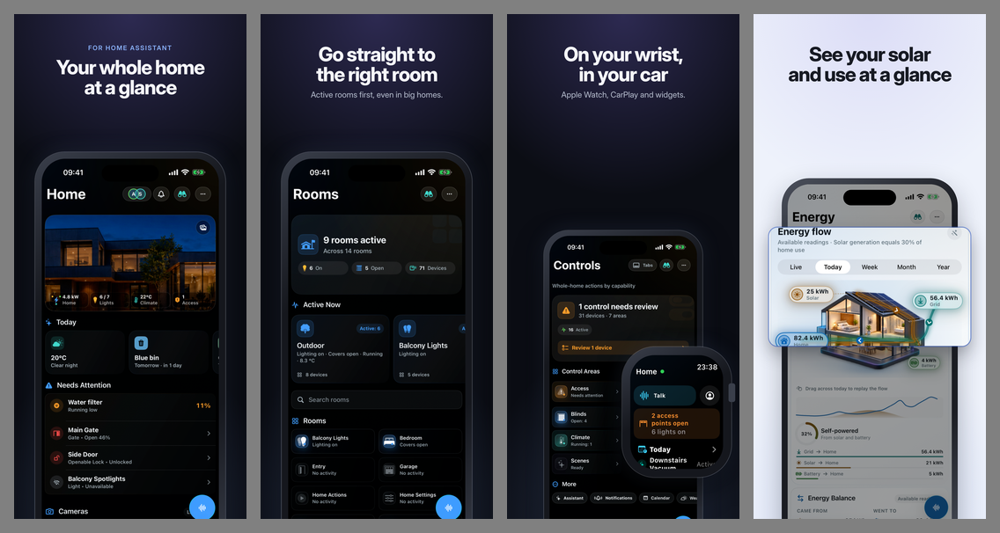

# Store artwork from real Apple captures

`powerforge-web apple-store-art compose` stages real PNG captures in captioned store frames. It uses the shared HtmlTinkerX Chromium renderer, drawn CSS shells, bundled fonts, and three themes: `casaray`, `tactra`, and `officeimo`. The original capture files are read without modification. Focus frames magnify a real rectangle and dim the surrounding screen, matching the shared visual template.

```sh
powerforge-web apple-store-art compose --config store-art.json --out build/appstore-screenshots/store-art
```

Use a fresh output directory for each candidate. All frames are staged first; a missing capture, missing caption, or overflowing locale fails the command without publishing a partial set. Browser installation uses HtmlTinkerX's shared cache. Once Chromium is installed, composition is offline: fonts and images are embedded, and rendered pages cannot fetch network resources. `--browser-executable` selects an already-qualified Chromium executable when needed.

See the [worked example](../Examples/AppleStoreArt/store-art.json), [English captions](../Examples/AppleStoreArt/store-captions.en-US.json), and [JSON schema](../Schemas/powerforge.apple.storeart.schema.json). Supply the raw captures named by the example from actual application scenarios before running it.



## Spec and captions

`captureRoot` resolves relative to the spec. Every input and the output directory must be inside that root, without symbolic links. `captures` maps scenario ids to files; `scenario@locale` takes precedence over `scenario`. A file reference may contain `{locale}`. Declare a capture's `locale` to reject accidental use in another listing locale. The capture workflow's provenance binds the raw files to the app commit, run, runtime, device, appearance and scenario.

`locales` lists every listing locale to render. Keep `store-captions.<locale>.json` under `captionsPath`. Frames select `headlineKey`, optional `eyebrowKey` and `sublineKey` from those files. Captions are plain text with optional newlines; headline `<em>...</em>` marks accent text. Other markup is escaped. Have a native speaker review the captions before approval.

Each frame has a stable `id`, `layout`, `capture`, and optional `devices` subset. Layouts are `hero`, `focus`, `pair` (phone and Watch), `surfaces` (widgets or Live Activity captures), `statement`, `ipad`, `mac`, and raw `watch`. `pair` adds a `watch` reference; `surfaces` adds a `surfaces` array. `focus` requires `lens.rect` in source capture pixels, with optional magnification `scale` and x/y `at` offset. `deviceWidth` and `watchWidth` use the prototype's canvas units. Set `island: false` when the capture already contains an island. `mood` selects the theme's `light` or `dark` variant.

The theme's `tokens` override CSS custom properties such as `--accent`, `--bg`, and `--h1`. The shared base, fonts and brand themes ship with PowerForge. Values cannot load external CSS or resources. Inter, Hanken Grotesk, JetBrains Mono and Noto Sans CJK are bundled with their OFL licenses and source hashes. Font tokens select these bundled families; system fonts cannot supply missing characters. Caption glyphs are checked against the embedded fonts before rendering. Unsupported scripts fail with the locale, frame, code point and missing font, for example `Locale 'ar', frame 'home': missing offline font 'Noto Sans Arabic' for U+0627`. Arabic, Hebrew, Devanagari and Thai fonts are not bundled.

Headlines use two lines at most. The compositor waits for fonts and decoded images, then shrinks the headline only as needed, down to 88 px on the 1320 canvas. An unresolved overflow names the locale, frame and device. Short Duo canvases may need shorter copy or a smaller device width.

## Outputs and review

| Device key | PNG size |
| --- | --- |
| `iphone-69` | 1320 × 2868 |
| `iphone-63` | 1206 × 2622 |
| `duo-outer` | 1398 × 2034 |
| `duo-inner` | 2007 × 2853 |
| `ipad-13` | 2064 × 2752 |
| `mac` | 2880 × 1800 |
| `watch` | 416 × 496 |

Duo keys describe local geometry; they do not add App Store Connect display types. Map output folders to supported display types in the existing screenshot sync config. Phone layouts select phone/Duo devices by default; `ipad`, `mac`, and `watch` select their corresponding device. Explicit frame `devices` overrides that selection.

PNGs are written under `<locale>/<device>/` in listing order. Captioned outputs are RGB PNGs with exact dimensions and no alpha. Watch requires an opaque 416 × 496 input, adds no captions or resizing, and allows at most five frames. RGB files pass through byte-for-byte. An unused opaque alpha channel is removed while preserving every RGB sample; translucent captures are rejected. Contact sheets live under `_review/`, outside upload folders. Review the full-size frames as well as each contact sheet.

`store-art.lineage.json` records output SHA-256, a versioned 64-bit grayscale difference hash in `PerceptualHash`, raw capture paths/hashes/dimensions, frame, theme, locale, device, spec hash, caption hash, template/font hash, final HTML hash and Chromium version. Use the same Chromium version and bundled fonts for byte-identical reproduction. Compare perceptual hashes when qualifying a browser/platform change; an identical perceptual hash alone does not establish pixel equality.

## Capture and approval

For local composition against a retained raw capture inventory:

```sh
powerforge apple-screenshots manifest --config screenshots.json \
  --capture-provenance build/capture-provenance.json \
  --expected-repository EvotecIT/MyApp \
  --expected-workflow-ref EvotecIT/MyApp/.github/workflows/apple-screenshots.yml@refs/heads/main \
  --store-art-lineage build/appstore-screenshots/store-art/store-art.lineage.json \
  --approved-by release-reviewer --allowed-root build/appstore-screenshots
```

Every composed input must be an exact member of the raw provenance inventory and still match its retained bytes. Every selected output must match its composition hash and listing locale. The approval manifest uses schema v3 for composed entries and retains the complete lineage and perceptual hash. Upload still requires exact approved output bytes. Existing raw-only schema v2 inventories and manifests remain supported.

The reusable `apple-screenshot-capture` action accepts opt-in `store_art_spec` and `store_art_tool_ref` inputs. The latter pins the exact PowerForge commit containing this command. The action inventories raw PNGs first, composes into `<capture_artifact_path>/store-art`, then records capture provenance v3 with separate `screenshots` and `compositions` inventories. Its spec must be tracked at the captured commit and `captureRoot` must equal `capture_artifact_path`. With both inputs blank, capture remains raw-only. The existing approval readers accept v3; no upload or publication operation is added.

App repositories own their scenarios, captions and adoption. This compositor does not create missing UI states or assemble preview videos.
